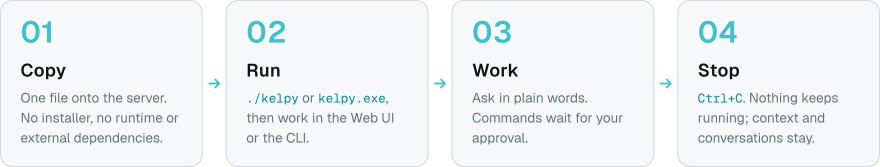

<p align="center">
  <picture>
    <source media="(prefers-color-scheme: dark)" srcset="brand/kelpy-lockup-horizontal-dark.svg">
    
  </picture>
</p>

<p align="center"><strong>AI-powered system administration. One binary. No installation required.</strong></p>

Kelpy is a lightweight AI assistant for system administrators, shipped as a single executable. The agent runtime,
local server and Web UI are built in: no Node.js, Python, Docker or external database required.

<p align="center">
  <picture>
    <source media="(max-width: 600px) and (prefers-color-scheme: dark)" srcset="brand/kelpy-usage-mobile-dark.svg">
    <source media="(max-width: 600px)" srcset="brand/kelpy-usage-mobile-light.svg">
    <source media="(prefers-color-scheme: dark)" srcset="brand/kelpy-usage-dark.svg">
    
  </picture>
</p>

Typical uses:

- Install and configure a WordPress stack with nginx, PHP and MariaDB.
- Set up websites and application pools in IIS on Windows Server.
- Diagnose failing services using their status, logs and configuration.
- Investigate port conflicts, disk-space problems and resource usage.

Kelpy supports OpenAI and ChatGPT (Codex CLI or agent sign-in), Anthropic's Claude API, any OpenAI-compatible
service, and local models served by Ollama.

The [wiki](https://github.com/Ryadel/Kelpy/wiki) covers installation, the AI services, the command line, security
and troubleshooting.

## Principles

- **Single binary**: one self-contained executable per platform.
- **Never persistent**: no service, no daemon: Kelpy's own access ends with the session; what you approved on the
  server stays.
- **Zero-configuration startup**: the first run asks one question, then you are in.
- **Web UI and terminal UI**: two interfaces over the same runtime and the same data.
- **Local-first**: everything runs and is stored on your machine; Kelpy talks only to the AI providers you choose.
- **Provider-agnostic**: cloud providers and local models.
- **Secure by default**: loopback only, authenticated API, explicit approval for sensitive operations.

## Getting started

Run the executable:

```text
kelpy
```

The first run asks where Kelpy should live (by default `~/Kelpy`), installs itself there and, if you want, adds
that folder to your PATH, with no administrator rights needed. Everything Kelpy owns stays in that one folder:

```text
Kelpy/
  kelpy[.exe]     the executable
  config.toml     configuration, including the AI provider and model (never API keys)
  data/           database and runtime state
  memory/         persistent memory, as Markdown files you can read and edit
  workspace/      default workspace for the agent's tools
  logs/
```

Later runs start straight away and print the Web UI address with a one-click sign-in link, and the access code
for signing in from another browser. The code is new at every start:

```text
Kelpy v0.1.0

Agent runtime started.
Web UI: http://127.0.0.1:54321/#code=K7QM-4ZP2
Code:   K7QM-4ZP2  (to sign in from another browser)
Home:   C:\Users\you\Kelpy

Press Ctrl+C to stop.
```

When Kelpy runs in an SSH session, it also prints the command to run on your own computer to reach the Web UI
through SSH, for example `ssh -N -L 54321:127.0.0.1:54321 root@203.0.113.10`; the link above then works there
unchanged. Nothing new is exposed on the server.

### Commands

| Command | Purpose |
|---|---|
| `kelpy` | Start the runtime and the Web UI in the foreground |
| `kelpy status` | Show whether Kelpy is running, with its PID, port, URL and access code |
| `kelpy open` | Open the Web UI in the browser, already signed in |
| `kelpy stop` | Stop the running Kelpy, for example from another terminal |
| `kelpy provider` | Choose how Kelpy connects to AI; with `--service`, without questions |
| `kelpy cleanup` | Remove Kelpy from this computer: its files in the home (conversations and memory included), the PATH entry and the record of the home; other files in the folder are kept. Asks first; `--yes` confirms in scripts |
| `kelpy --version` | Show the installed version |

Kelpy can also be stopped from the Web UI (*Stop Kelpy*). Either way it stops in order: answers being written are
kept as incomplete. Kelpy never runs in the background: it lives in the terminal that started it.
`kelpy tui`, `kelpy config` and `kelpy chat` are planned.

### AI provider

Choose the provider and model in the Web UI (it asks on the first visit), or run `kelpy provider`:

| Way | Services |
|---|---|
| ChatGPT plan | sign in as Codex CLI, with a code, or as an agent |
| Free online service | Google Gemini, Groq, OpenRouter, Mistral, within their limits |
| API key | Anthropic (`ANTHROPIC_API_KEY`), OpenAI (`OPENAI_API_KEY`), any OpenAI-compatible service |
| Local model | Ollama (models listed, suggested and downloaded from the Web UI), any OpenAI-compatible server |

Models are listed by the service. The choice is saved in `config.toml`. An API key entered in the Web UI or the
terminal is kept in memory only, until Kelpy stops; a ChatGPT sign-in too, unless you save it on
this computer. The [wiki](https://github.com/Ryadel/Kelpy/wiki/Connecting-to-AI) describes each way. Answers are streamed as they are
written and keep going if you close the page; *Stop* interrupts them. Every open page shows what is done in the
others as it happens: new conversations, messages and answers, the provider. Conversations are stored in
`data/kelpy.db`.
When a conversation no longer fits what the model can read, the model summarises its older messages and Kelpy sends
the summary with the recent ones. The conversation is kept whole, with the line *Earlier messages summarised for the
model* above the first message the model still reads in full. Answers are concise; turn on *Explanations* under the message box for a conversation where you want each step
explained in plain words: what it does and why, what to expect, and how to check it worked. The answer stays concise,
and each explanation shows in a panel under its step; *Close explanations* under the answer folds them all. Every
code block and panel has its own *Copy*, and *Copy* under an answer takes it whole, in Markdown.

Options:

| Option | Effect |
|---|---|
| `--home <PATH>` | Use this folder as the Kelpy home, without installing anything (also `KELPY_HOME`) |
| `--yes` | Accept every first-run default |
| `--shutdown-after <DURATION>` | Stop after this time, e.g. `30m`, `2h`, `1h30m` |
| `--shutdown-idle <DURATION>` | Stop after this long without activity; work in progress always counts as activity |

Kelpy never runs as a service. It stops on Ctrl+C, when its terminal session ends, or at one of the limits above;
in every case new work is refused at once, answers being written are stopped and saved, and open connections get
at most 10 seconds to close. To keep it available on a schedule,
start it from cron or Task Scheduler with a limit:

```sh
kelpy --home /root/Kelpy --shutdown-idle 30m
```

### System access

Two selectors under the message box decide, for each conversation, what Kelpy may do on the system and when it
asks: *System access* None, Read-only (the default) or Full, and *Approval mode* Ask (the default), Plan or Auto.
With Read-only, Kelpy looks before it answers: services, installed software, listening ports, disks, processes,
logs, files. Each look is an action shown in the answer with its exact command and its reason, and with Ask it
waits for *Approve* or *Deny*. These commands are fixed by Kelpy and only read; files that may hold secrets are
never read. With Full, Kelpy changes files, services, packages (apt) and MariaDB or MySQL databases through
operations it understands: the card shows the change first (a diff, what apt would install, the service's state),
files are backed up, and the result is checked, with what can be put back put back when the check fails. A change
already made is not made again. Passwords are secrets Kelpy generates and the AI model never sees. With Plan, Kelpy
proposes the changes as one plan, approved once. For anything else, Kelpy writes a command (PowerShell or bash),
shown verbatim and approved first. The *Command log*, opened from the top bar, lists every action of the
conversation; there *Restore* puts a file back from its backup, and *Report* gives the handover report. Kelpy
notices when something it changed was changed outside it, shows the difference and never reverts it by itself. What
Kelpy reads is sent to the AI service. The [wiki](https://github.com/Ryadel/Kelpy/wiki/System-access) has the
details.

## Building from source

Requirements: [Rust](https://rustup.rs) 1.89 or later, and [Bun](https://bun.sh) to build the Web UI. On Windows,
Rust also needs the Visual Studio C++ build tools.

```sh
cd web
bun install
bun run build
cd ..
cargo build --release
```

The Web UI is embedded into the executable at compile time; the result is `target/release/kelpy` (`kelpy.exe` on
Windows). Building without the Web UI still works: the server then shows a page explaining how to build it.

### Development

```sh
cargo test --workspace
cargo clippy --workspace --all-targets -- -D warnings
cargo fmt --all
cd web && bun run check
```

Use a throwaway home while developing, so that your real installation is untouched. One command stops the Kelpy
running on that home, builds the Web UI and the executable, and starts Kelpy again; options are passed on to Kelpy:

```sh
bun scripts/dev-start.ts
bun scripts/dev-start.ts --shutdown-idle 30m
```

It works on Windows, Linux and macOS. Stopping comes first because Windows cannot replace a running executable.
Without the script: `cargo run -- --home target/dev-home`, after building the Web UI.

### Layout

```text
crates/
  kelpy/            the executable: command line, first run, runtime lifecycle
  kelpy-core/       home folder, configuration, owner-only files, the agent
  kelpy-gateway/    loopback HTTP server, request guards, authentication, conversation API (SSE), embedded Web UI
  kelpy-providers/  AI provider adapters: Anthropic, OpenAI-compatible (OpenAI, Ollama, others), streaming, tool calls
  kelpy-storage/    conversations, messages, actions and summaries in SQLite
  kelpy-tools/      what the model may use to look at the system, and the executor that runs it
web/                Web UI (Svelte + TypeScript, shadcn-svelte components, Tailwind CSS, built with Vite)
```

## Security

The server listens on loopback only. It rejects requests whose `Host` is not its own loopback address (protecting
against DNS rebinding) and state-changing requests from other origins, and forbids embedding the Web UI in other
pages.

The API answers only authenticated requests:

- **Browsers** sign in with the access code printed in the terminal. The one-click link carries it in the URL
  fragment, which is never sent to the server, and the Web UI removes it from the address bar. The code is
  exchanged for a session valid until Kelpy stops. The Web UI keeps it in the browser's storage for its own address
  and port, never in a cookie, which browsers would also send to other programs on the same computer. Before
  sending it, the Web UI has Kelpy prove that it knows the session, with an HMAC of a random challenge: if an SSH
  tunnel drops and another program takes its port, the session does not reach that program. Wrong codes are rate
  limited.
- **Local clients** use a token stored in `data/runtime.json`, a file only the user who started Kelpy can open.

The `data/` folder, which holds the conversations and the runtime's credentials, is restricted to the user who
started Kelpy.

Both the code and the token are random and change at every start.

## License

Licensed under either of

- Apache License, Version 2.0 ([LICENSE-APACHE](LICENSE-APACHE))
- MIT license ([LICENSE-MIT](LICENSE-MIT))

at your option.

The folklore waiting-hint data has separate Creative Commons licenses and source credits; see the
[catalog notice](web/src/lib/folklore/NOTICE.md).

Unless you explicitly state otherwise, any contribution intentionally submitted for inclusion in the work by you,
as defined in the Apache-2.0 license, shall be dual licensed as above, without any additional terms or conditions.
